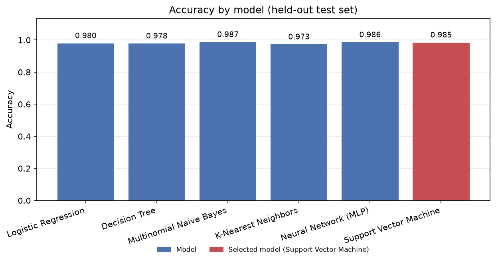
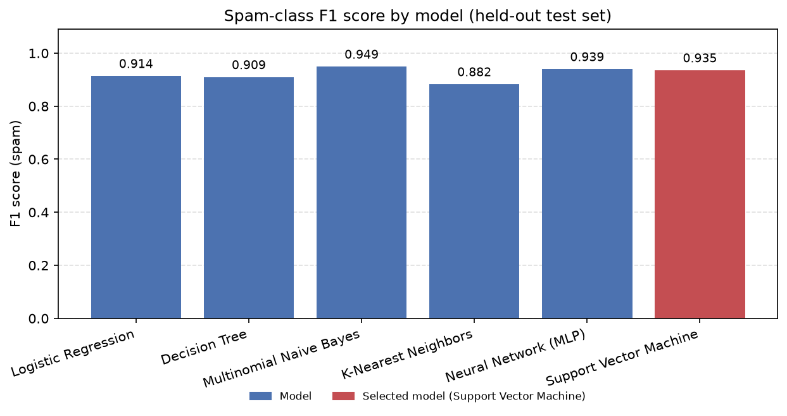
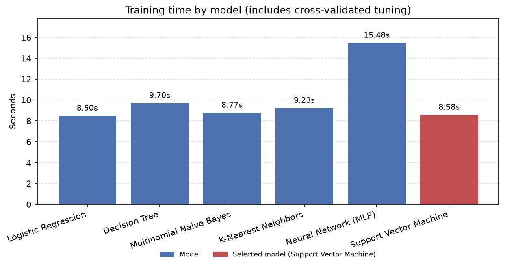

# SpamShield — SMS Spam Detection & ML Algorithm Comparison

[](https://github.com/Fe4rlessCloak/SpamShield/actions/workflows/tests.yml)

A small but complete university Machine Learning midterm project: it classifies SMS
messages as **spam** or **ham (legitimate)** with **six** different algorithms, compares
how well each one performs, and serves the result through an interactive Streamlit
dashboard.

Everything here is reproducible: a pinned Python version, locked dependencies, fixed
random seeds, a checksum-verified dataset, saved metrics and an automated test suite.

## Features

- Six classifiers trained on identical data, splits and features.
- A leakage-safe pipeline: TF-IDF lives inside the model pipeline, so it only ever sees
  training data — cross-validation included.
- Dataset validation: empty messages, exact duplicates and conflicting labels are
  detected, reported and resolved **before** splitting.
- Real measurements — accuracy, spam precision/recall/F1, confusion matrices, training
  and inference times, and peak traced memory.
- Saved metrics as CSV + JSON, and generated comparison charts.
- A four-page Streamlit app: SMS Detector, Model Comparison, Dataset Explorer, About.
- 61 offline tests (no network, no trained artifacts required) plus a GitHub Actions
  workflow that lints and tests every push.

## Machine learning algorithms

| # | Algorithm               | scikit-learn estimator   | Lab    |
| - | ----------------------- | ------------------------ | ------ |
| 1 | Logistic Regression     | `LogisticRegression`     | Lab 03 |
| 2 | Decision Tree           | `DecisionTreeClassifier` | Lab 04 |
| 3 | Multinomial Naive Bayes | `MultinomialNB`          | Lab 05 |
| 4 | K-Nearest Neighbors     | `KNeighborsClassifier`   | Lab 06 |
| 5 | Neural Network (MLP)    | `MLPClassifier`          | Lab 07 |
| 6 | Support Vector Machine  | `LinearSVC`              | Lab 08 |

## Dataset

**SMS Spam Collection**, UCI Machine Learning Repository (dataset id
[228](https://archive.ics.uci.edu/dataset/228/sms+spam+collection)), licensed
**CC BY 4.0**.

> Almeida, T. A., Gomez Hidalgo, J. M., & Yamakami, A. (2011). *Contributions to the
> Study of SMS Spam Filtering: New Collection and Results.* Proceedings of the 2011 ACM
> Symposium on Document Engineering (DocEng '11), Mountain View, CA, USA.

- 5,574 raw labelled messages (4,827 ham / 747 spam), stored as tab-separated
  `label<TAB>message` records.
- Downloaded on first use from
  `https://archive.ics.uci.edu/static/public/228/sms+spam+collection.zip`, cached in
  `data/raw/`, and verified with a **SHA-256 checksum** recorded in
  `data/raw/dataset_metadata.json`. Later runs are fully offline.
- The raw payload is **not** committed (it is cached and checksum-verified instead); the
  metadata manifest that identifies it is.

### Data quality handling

| Issue                                | Handling                                                                               |
| ------------------------------------ | -------------------------------------------------------------------------------------- |
| Missing / whitespace-only messages   | Detected and dropped during validation                                                  |
| Exact duplicate messages             | Identified and dropped **before** the split, so a message cannot appear in both the training and the test set |
| Identical message, conflicting label | Detected, counted and reported; the first occurrence is kept deterministically          |
| Quoted message text                  | Quote processing is disabled while parsing — otherwise rows are lost and the collection shrinks from 5,574 to 5,572 records |
| Unknown labels                       | Detected and dropped, with a count in the validation report                             |

Result on the real file: **5,574 raw rows → 5,171 unique messages** (403 duplicate rows
removed, 0 conflicting-label messages, 0 empty messages).

## Preprocessing

- **Normalisation**: Unicode NFKC, lower-casing, whitespace collapsing. Numbers, currency
  symbols, punctuation and SMS abbreviations are deliberately **kept** — they carry much
  of the spam signal. Aggressive cleaning is avoided on purpose.
- **Features**: `TfidfVectorizer` with `max_features=4000`, unigrams + bigrams,
  `min_df=2`, `sublinear_tf=True`. Numbers and single-character tokens survive, so things
  like `£1000`, `50%` and `u` are still features.
- **Leakage safety**: the vectorizer and the classifier live in one
  `sklearn.pipeline.Pipeline`, so the vocabulary and IDF statistics are always learned
  from the training fold only — including during cross-validation.
- **Split**: fixed, stratified 80/20 with `random_state=42` → 4,136 train / 1,035 test
  messages. The test set is untouched until final evaluation.

## Performance comparison

All six models share the same cleaned dataset, the same split and the same TF-IDF
representation, so the numbers below are directly comparable. They are produced by
actually running the pipeline — regenerate them with `uv run python -m spamshield.train`.

| Model                   | Accuracy | P (spam) | R (spam) | F1 (spam) | CV F1 (spam) | Train (s) | Inference (ms/msg) | Peak traced mem (MB) |
| ----------------------- | -------- | -------- | -------- | --------- | ------------ | --------- | ------------------ | -------------------- |
| Logistic Regression     | 0.9797   | 0.9911   | 0.8473   | 0.9136    | 0.9389       | 8.50      | 0.0179             | 12.04                |
| Decision Tree           | 0.9778   | 0.9426   | 0.8779   | 0.9091    | 0.8785       | 9.70      | 0.0175             | 11.98                |
| Multinomial Naive Bayes | 0.9874   | 0.9836   | 0.9160   | 0.9486    | 0.9466       | 8.77      | 0.0175             | 11.98                |
| K-Nearest Neighbors     | 0.9729   | 0.9813   | 0.8015   | 0.8824    | 0.9232       | 9.23      | 0.0842             | 73.58                |
| Neural Network (MLP)    | 0.9855   | 1.0000   | 0.8855   | 0.9393    | 0.9330       | 15.48     | 0.0182             | 25.85                |
| Support Vector Machine  | 0.9845   | 1.0000   | 0.8779   | 0.9350    | 0.9553       | 8.58      | 0.0170             | 11.96                |

`P`, `R` and `F1` are computed for the **spam** class, which is the minority class
(131 of the 1,035 test messages) and therefore the class that matters. Accuracy alone is
misleading here: a model that never predicted spam would still score ~87%.

### Selecting a model

The model is selected using **training-only cross-validated spam F1**, as required for a
fair evaluation; the test set is reported afterwards for all six models and is never used
to pick the winner. That selects the **Support Vector Machine** (CV F1 0.9553).

On the held-out test set Multinomial Naive Bayes scores *slightly* higher (F1 0.9486 vs
0.9350). The two are within the noise of a 131-spam test set, and the gap is a good
illustration of why repeatedly optimising against test results overfits the test set.

### Trade-offs

- **Naive Bayes** is the cheapest strong option: fastest to train, the smallest memory
  footprint, and the best test-set F1 here. Its independence assumption is clearly wrong
  for language, yet it works extremely well on sparse word counts.
- **Support Vector Machine** is very precise (no false positives on the test set) and the
  most consistent under cross-validation, but its recall is lower — it misses about 12% of
  spam. It also cannot produce probabilities, so the app shows a decision score instead.
- **Neural Network (MLP)** is the slowest to train and needs the most memory for accuracy
  comparable to the linear models. One hidden layer is enough here; the extra cost buys
  little on 4,000 sparse features.
- **Logistic Regression** is fast, interpretable and reliable; its weakness is recall
  (0.8473), i.e. it lets more spam through than the other strong models.
- **Decision Tree** is the easiest to explain (if/else rules) but the weakest performer
  and the most prone to overfitting, which the depth tuning only partly controls.
- **K-Nearest Neighbors** is the slowest at inference and the most memory-hungry because
  it keeps the whole training set and compares against it at prediction time. It also has
  the worst recall.

Peak memory is measured with `tracemalloc`, which traces **Python-level allocations only**.
It does not include memory held by native numerical libraries and is **not** total process
memory. The hyperparameter search runs with a single worker precisely so that this
measurement includes the fitting work instead of being split across untraced subprocesses.

## Visualisations

Generated by the training pipeline into `reports/figures/`.







Confusion matrices for every model, plus precision, recall and inference-time charts, are
saved in the same directory — for example
`reports/figures/confusion_matrix_naive_bayes.png`.

## Technology stack

- **Python 3.12** — pinned in `.python-version`
- **uv** — Python version selection, virtual environments, `pyproject.toml` + `uv.lock`
- **pandas / NumPy** — data handling
- **scikit-learn** — ML, TF-IDF and pipelines
- **Matplotlib / Seaborn** — visualisations
- **Streamlit** — frontend
- **joblib** — model serialization
- **pytest** — tests, **Ruff** — linting and formatting
- **GitHub Actions** — continuous integration

No Poetry, Pipenv, Conda or hand-managed `requirements.txt` is used.

## Installation

Prerequisite: [uv](https://docs.astral.sh/uv/) installed. uv fetches the pinned Python
version itself, so no system Python setup is needed.

```bash
git clone https://github.com/Fe4rlessCloak/SpamShield.git
cd SpamShield
uv sync --locked
```

`uv sync --locked` installs the exact versions from `uv.lock` into `.venv`.

## Training and evaluation

```bash
uv run python -m spamshield.train
```

This single command:

1. downloads the dataset if it is not cached, and verifies its SHA-256 checksum;
2. validates and de-duplicates it;
3. creates the fixed stratified 80/20 split;
4. tunes and trains all six models (cross-validated, training data only);
5. saves each fitted `TF-IDF → classifier` pipeline to `artifacts/models/*.joblib`;
6. evaluates every model on the held-out test set;
7. writes `artifacts/metrics/metrics.csv`, `metrics.json` and
   `artifacts/metrics/training_report.json`;
8. renders the comparison charts into `reports/figures/`.

To re-run evaluation only (models must already exist):

```bash
uv run python -m spamshield.evaluate
```

## Running the frontend

```bash
uv run streamlit run app.py
```

- **SMS Detector** — type a message, choose a model, get a SPAM/HAM verdict. Models that
  support `predict_proba` show a confidence score; `LinearSVC` shows a signed decision
  score instead, clearly labelled as *not* a probability.
- **Model Comparison** — the metrics table, charts, confusion matrices and classification
  reports, loaded from the saved artifacts.
- **Dataset Explorer** — class distribution, length statistics, example messages and the
  dataset attribution.
- **About the Project** — how classification works, the pipeline, the Lab 1–8 mapping and
  the limitations.

The app never trains anything on launch. If the artifacts are missing, the page shows the
exact training command to run instead.

## Running the tests

```bash
uv run pytest          # offline, no trained models needed
uv run ruff check .    # lint
uv run ruff format --check .
```

## Project structure

```
spamshield/
├── README.md
├── pyproject.toml
├── uv.lock
├── .python-version
├── app.py                       # Streamlit entry point (navigation only)
├── pages/                       # the four dashboard pages
│   ├── 1_SMS_Detector.py
│   ├── 2_Model_Comparison.py
│   ├── 3_Dataset_Explorer.py
│   └── 4_About.py
├── data/raw/                    # dataset cache (payload ignored, metadata committed)
├── src/spamshield/
│   ├── constants.py             # paths, seeds, label map, feature config
│   ├── data.py                  # download, checksum, validation, statistics
│   ├── preprocessing.py         # normalisation, TF-IDF, leakage-safe pipelines
│   ├── models.py                # the six algorithms and their hyperparameter grids
│   ├── train.py                 # training pipeline and model serialization
│   ├── evaluate.py              # metrics, comparison table, figures
│   ├── predict.py               # inference API (Streamlit-free)
│   ├── ui.py                    # cached Streamlit helpers
│   └── utils.py                 # plotting helpers
├── artifacts/                   # models/ (regenerated) and metrics/ (committed)
├── reports/figures/             # generated charts
├── tests/                       # pytest suite + fixtures
└── .github/workflows/tests.yml  # CI: uv, Ruff, pytest
```

## Lab 1–8 coverage

| Lab    | Topic                    | Where it is implemented                                                                                                                                          | Result                         |
| ------ | ------------------------ | ---------------------------------------------------------------------------------------------------------------------------------------------------------------- | ------------------------------ |
| Lab 01 | Python basics            | Functions, loops, conditionals and input validation across `src/spamshield/`; CLI entry points in `data.py`, `train.py` and `evaluate.py`                          | infrastructure for all results |
| Lab 02 | Data structures & memory | Dict/list model registry, dataclasses (`ModelSpec`, `DatasetReport`, `DataBundle`, `Prediction`); peak memory measured with `tracemalloc` in `train.train_model`     | peak traced memory per model   |
| Lab 03 | Regression               | `LogisticRegression` in `models.py`                                                                                                                               | spam F1 **0.9136**             |
| Lab 04 | Decision tree            | `DecisionTreeClassifier` in `models.py`                                                                                                                           | spam F1 **0.9091**             |
| Lab 05 | Naive Bayes              | `MultinomialNB` in `models.py`                                                                                                                                    | spam F1 **0.9486**             |
| Lab 06 | K-nearest neighbors      | `KNeighborsClassifier` (cosine) in `models.py`                                                                                                                    | spam F1 **0.8824**             |
| Lab 07 | Artificial neural network| `MLPClassifier` (one hidden layer) in `models.py`                                                                                                                 | spam F1 **0.9393**             |
| Lab 08 | Support vector machine   | `LinearSVC` in `models.py`                                                                                                                                        | spam F1 **0.9350**             |

Lab 03 covers regression, but ordinary Linear Regression is not appropriate for spam/ham
labels, so Logistic Regression — a classification model from the same family — is used
instead.

## Reproducibility

- Locked dependencies (`uv.lock`) and a pinned Python version (`.python-version`).
- Fixed random seed (`42`) for the split, the hyperparameter search and stochastic models.
- A checksum-verified dataset; it is downloaded once and reused, so training is offline
  afterwards.
- Documented preprocessing settings and a fixed, stratified train/test split.
- Saved evaluation results (`artifacts/metrics/`) and figures (`reports/figures/`).
- Tests that need neither the network nor trained artifacts.
- `.gitignore` excludes `.venv`, caches, the raw dataset payload, trained model binaries
  and private configuration.

The documented commands were executed, not just written down.

## Limitations and future improvements

- **The dataset is small and old.** The SMS Spam Collection was collected around 2011 and
  mostly reflects the language and messaging style of its original sources. Spam wording
  has changed a lot since.
- **No claim of generalisation.** This classifier demonstrates algorithms; it should not
  be assumed to work reliably on modern SMS, on other languages, or against current
  phishing and smishing techniques. It is unlikely to transfer as-is.
- **Bag-of-words only.** TF-IDF ignores word order and meaning, and the models are classic
  shallow learners. Detection is keyword-driven, so unusual but legitimate wording can be
  misclassified.
- **Imbalanced classes.** Spam is ~13% of the data, so recall matters more than accuracy;
  the best models still miss roughly 8–12% of spam.
- **Memory figures are approximate** (see the `tracemalloc` note above), and `LinearSVC`
  has no probability output.
- **Out of scope by design:** user accounts, a database, Docker, a separate backend, paid
  APIs, LLM-based detection, real-time SMS interception and deployment infrastructure.

Possible next steps: calibration (e.g. `CalibratedClassifierCV`) to give the SVM honest
probabilities, character n-grams to be more robust to obfuscated spam, a threshold sweep
to trade precision against recall, and evaluation on a modern SMS dataset to see how far
these models actually transfer.
